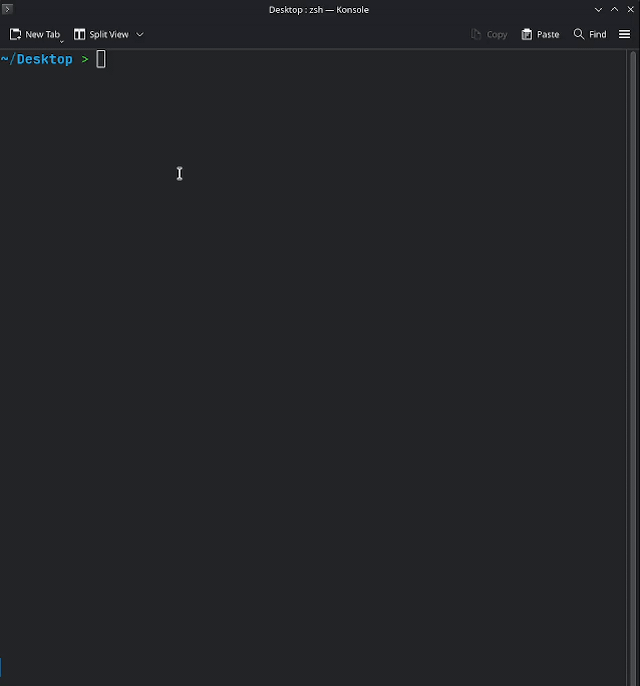

# ccp
(crate: `ccp_tree`)

> 📸 Snapshot · 📋 Blueprint · 🏗️ Scaffold  
> Capture a directory into a portable format and recreate it anywhere.

[](https://crates.io/crates/ccp_tree)
[](LICENSE)

`ccp` is a command‑line tool I built for daily use. It turns a folder into a human‑readable, copy‑paste‑friendly **snapshot**, and that same snapshot back into a real directory tree. Written in Rust 🦀 with a lot of love ❤️.

- 📄 **Snapshot** a project to Markdown (full content + tree) or a concise `.tree` definition.
- 📋 **Blueprint** – a single file that represents your entire project structure and contents.
- 🏗️ **Scaffold** – recreate the layout with a single command; perfect for bootstrapping, sharing ideas, or feeding LLMs full context.

It’s built for quick pasting into chat windows, code reviews, bug reports, and for generating repeatable project templates. Kinda neat actually 😄.

<p align="center">
  
</p>


---

## Features ✨

- 📄 **Markdown output** – full project tree + every file inside fenced code blocks.
- 🌲 **Tree‑only mode** (`--structure`) – just the directory hierarchy and structure.
- 🔁 **Reverse mode** – emit a `.tree` definition that can later be rebuilt.
- 🛠️ **Generate / Create** – turn a `.tree` definition (file, inline, or template) into real files.
- 🧩 **Template system** – bundled templates (Python, …) + custom templates directory.
- 🔍 **Smart ignores** – respects `.gitignore` / `.ignore`, plus a comprehensive default exclude list (node_modules, target, __pycache__, …).
- 📋 **Clipboard support** – optional; copies output directly to the clipboard.
- 🧹 **Flexible filtering** – include hidden files, skip default ignores, add custom glob patterns, limit file size.
- 🗂️ **File-type filtering** – include only files with a requested extension while preserving their directory paths.
- 🎨 **Colored tree preview** – visual inspection with `--dry-run`.
- 🖱️ **Desktop launcher generation (Linux)** – create a clickable launcher that runs `ccp -c` in that project folder.

---

## Installation

### Install from crates.io

```bash
cargo install ccp_tree
```

Check for a newer release at any time and install it with:

```bash
ccp update
```

When a newer version is available, normal `ccp` commands print a
non-blocking notification with the `ccp update` command. The check uses
crates.io and does not prevent offline use.

See [CHANGELOG.md](CHANGELOG.md) for version history and release changes.

This installs the `ccp` binary.  
To enable clipboard support (optional, works out‑of‑the‑box on most systems):

```bash
cargo install ccp_tree --features clipboard
```

> On Linux, the clipboard feature tries `wl-copy` (Wayland) and `xclip` (X11) first, then falls back to the `arboard` crate. No extra configuration needed. 👍


### Install from the Arch User Repository

```bash
yay -S ccp_tree
```


### Install with NixOS

#### Add ccp as a flake input

In your system flake's `flake.nix`, add ccp to `inputs`:

```nix
inputs = {
  nixpkgs.url = "github:NixOS/nixpkgs/nixos-unstable";
  ccp.url = "github:aradpilevarjavid/ccp_tree";
  ...
};
```

#### Import the module in your NixOS configuration

Pass `ccp` through to your modules (e.g. via `specialArgs` if using
flakes directly, or however your setup threads flake inputs to modules),
then import it alongside your other modules:

```nix
outputs = { self, nixpkgs, ... }@inputs: {
  nixosConfigurations.yourhostname = nixpkgs.lib.nixosSystem {
    system = "x86_64-linux";
    modules = [
      ./configuration.nix
      inputs.ccp.nixosModules.default
      # ...your other modules
    ];
  };
};
```

#### Add the package in your system configuration

Add it to your system packages inside ```environment.systemPackages``` or to your user packages using [home-manager](https://github.com/nix-community/home-manager) by adding it inside of ```home.packages```.


## Man Pages 📚

`ccp` ships with man pages for the main commands: `ccp`, `ccp-generate`, and `ccp-reverse`.  
How you get them depends on your installation method.

### Installed via AUR (Arch Linux)
Man pages are installed automatically – just run:

```bash
man ccp
man ccp-generate
man ccp-reverse
```

### Installed via `cargo install`
Cargo does **not** install man pages by default. To install them manually:

1. **Generate the man pages** (this uses the `ccp-mangen` binary that comes with the crate):

   ```bash
   cargo run --release --bin ccp-mangen -- --output-dir /tmp/ccp-man
   ```

2. **Install them for your user** (no `sudo` required):

   ```bash
   mkdir -p ~/.local/share/man/man1
   cp /tmp/ccp-man/*.1 ~/.local/share/man/man1/
   ```

3. **Make `man` aware of the location**. Add this line to your `~/.bashrc`, `~/.zshrc`, or equivalent:

   ```bash
   export MANPATH="$HOME/.local/share/man:$MANPATH"
   ```

   Then reload your shell:
   ```bash
   source ~/.bashrc   # or ~/.zshrc
   ```

4. **Test it**:
   ```bash
   man ccp
   ```

### Optional: system‑wide installation (requires `sudo`)
```bash
sudo cp /tmp/ccp-man/*.1 /usr/local/share/man/man1/
sudo mandb
```

### View man pages without installing
If you just want to read them once, you can pipe directly to `man`:

```bash
cargo run --quiet --bin ccp-mangen -- --stdout | man -l -
```

Or generate a single file and open it:
```bash
cargo run --release --bin ccp-mangen
man -l target/man/ccp.1
```

> **Tip:** `ccp-mangen --help` shows all output options (output dir, stdout, etc.).


---

## Configuration (`.ccprc`) ⚙️

`ccp` reads two optional TOML configuration files:

1. `./.ccprc` — local project configuration
2. `~/.ccprc` — global user configuration

Priority is: explicit CLI arguments > global config > local config > built-in
defaults. This means your global preferences remain authoritative, while the
local file can provide project defaults for settings not defined globally.

Example:

```toml
templates_dir = "templates"
clipboard = true
max_size = 1048576
max_chars = 12000
file_type = "rs"
exclude = ["*.generated", "secrets/"]
security_scan = false
quiet = false
```

Relative `templates_dir` paths are resolved from the directory containing the
`.ccprc` that defines them. Arrays such as `exclude` replace the lower-priority
array instead of being appended.

Most reusable flags can be configured, including `include_hidden`, `no_ignore`,
`all`, `file_type`, `head`, `tail`, `from_end`, `no_content`, `structure`,
`reverse`, `raw`, `dry_run`, `verbose`, `quiet`, `security_scan`, and `force`.

If `clipboard = true`, use `--no-clipboard` for a single command that should
print or write normally instead.

The repository includes a commented [`.ccprc`](.ccprc) example that can be
copied to your home directory and customized.

---

## Quick Start ⚡

Work from any directory; by default `ccp` scans the current folder.

```bash
ccp                    # full Markdown snapshot → stdout
ccp > snapshot.md      # save to file
ccp -o output.md       # write directly to a file
ccp -s                 # only the folder tree, no contents
ccp --reverse          # output a .tree definition
```

---

## Usage 🧑‍💻

### The fastest way to capture the structure and recreate in one pipe

```bash
ccp reverse | ccp generate -f -q
```

```
ccp [ROOT] [OPTIONS]
ccp reverse [ROOT] [OPTIONS]
ccp generate [ROOT] [OPTIONS]
ccp create [ROOT] [OPTIONS]        # alias for generate
ccp launcher [ROOT] [OPTIONS]
```

### 1. 📸 Snapshot a folder (default)

```bash
ccp                          # scan current directory
ccp /path/to/project -s      # structure only
ccp reverse /path/to/project --file-type rs  # Rust-only .tree definition
ccp /path/to/project -s --file-type rs  # only Rust files and their parent directories
ccp path/to/notebook.ipynb   # snapshot one notebook directly
ccp --raw                    # raw file contents only
ccp --reverse                # .tree definition
ccp --reverse --no-content   # .tree definition without file contents
```

Notebook files are rendered as Markdown cells, code, outputs, and errors. A
notebook can be passed directly as the root path, including notebooks saved
with a UTF-8 byte-order mark.

### 2. 🔁 Reverse – create a `.tree` template

```bash
ccp reverse                         # current dir
ccp reverse /path/to/project        # specific folder
ccp reverse -o template.tree        # write to file
ccp reverse --no-content            # omit file contents
```

### 3. 🏗️ Generate / Create – materialise a `.tree` definition

```bash
# From a .tree file
ccp generate --input blueprint.tree

# Into a specific folder
ccp generate ./my-new-project --input blueprint.tree

# From a bundled template
ccp create my-project --template python

# From a custom template
ccp generate --template react-component --templates-dir ./templates

# Inline definition (use \n for newlines)
ccp generate --inline "src/
  index.ts: export default {}
  README.md: # Hello"
```

**Overwrite safety:** the command asks before overwriting existing files.  
Use `--force` to skip prompts, and `--quiet` to suppress them entirely.

**Dry‑run** previews the files that would be created, without touching disk:

```bash
ccp generate --dry-run --input blueprint.tree
```

### 4. 🖱️ Launcher – create a double-click file for `ccp -c` (Linux)

```bash
ccp launcher                       # create launcher in current directory
ccp launcher /path/to/project      # create launcher in a specific directory
ccp launcher /path/to/project --force
```

This creates `ccp-copy.desktop` in the target directory.
Double-click it in your Linux file manager to run `ccp -c` against the
directory containing that launcher.

Notes:
- Linux desktop support only in this release.
- The launcher uses `ccp` from your `PATH` (no hardcoded binary path).
- If `ccp` is missing, or `ccp -c` fails, errors are shown in a terminal window.
- Most desktop environments require the file to be executable/trusted before
  launching (`chmod +x ccp-copy.desktop`; GNOME may still require marking as trusted).
- Existing unrelated `ccp-copy.desktop` files are never overwritten. Use
  `--force` only to replace a previously generated CCP launcher.

---

## The `.tree` Definition Format 📝

A lightweight, indentation‑based format that describes files and directories.

### Syntax Rules

- Each line is an entry, indented with **two spaces** per level.
- **Directories** end with a trailing `/`.  
  Example: `src/`
- **Files** are just the name.
  Empty files have no extra content marker.
- **Single‑line contents** follow a colon (`:`):  
  `README.md: # My Project`
- **Multi‑line contents** use a pipe `|` after the colon, then indent content lines by **two extra spaces**:  
  ```
  file.txt:|
    line one
    line two
  ```
- **Binary files** or files exceeding `--max-size` are automatically marked with
  their MIME type, detection method, size, and detected extension:
  `image.png: <binary file; MIME: image/png; detected by: content signature; size: 1,024 bytes; detected extension: png>`
- MIME detection prefers file signatures, falls back to the filename extension,
  and uses `application/octet-stream` when neither provides a match.
- UTF-16 text with a byte-order mark is decoded as text, while NUL bytes and
  suspicious control-byte sequences are treated as binary even when technically
  valid UTF-8.
- With `--security-scan`, `ccp` warns on stderr when it finds common
  credential patterns such as private keys, API keys, access tokens, JWTs, or
  password assignments. Warnings show only the file, line, and credential type;
  matched values are never printed. Security analysis is disabled by default;
  use `--exclude` to omit affected files.

### Example

```
src/
  main.rs: fn main() { println!("Hello"); }
  lib.rs
  utils/
    helpers.rs: |
      pub fn add(a: i32, b: i32) -> i32 {
          a + b
      }
      pub fn sub(a: i32, b: i32) -> i32 {
          a - b
      }
README.md: # My Project
Cargo.toml: |
  [package]
  name = "my-project"
  version = "0.1.0"
```

This definition can be saved as a `.tree` file and reused with `ccp generate`.

---

## Options ⚙️

### Global / `ccp` (snapshot) & `ccp reverse` options
### if you run ccp --help you will see:

| Flag / Option               | Description |
|-----------------------------|-------------|
| `--include-hidden`          | Include dot‑files and dot‑folders. |
| `--no-ignore`               | Ignore `.gitignore` and `.ignore` files. |
| `-a`, `--all`               | Include default‑excluded directories (target, node_modules, …). |
| `-e`, `--exclude <PAT>`     | Exclude additional glob patterns (repeatable). |
| `--file-type <EXTENSION>`   | Include only files with this final extension (for example `rs` or `.rs`). |
| `--max-size <BYTES>`        | Skip files larger than this size (default: 1 MB). |
| `--max-chars <CHARS>`        | Limit the number of characters read from each file (for AI context windows). |
| `--structure`, `-s`         | Output only the directory tree (Markdown). |
| `--raw`                     | Output raw file contents only; cannot be combined with `-s`. |
| `-r`                        | Apply character limits from the end of each file. |
| `--reverse`                 | Output in `.tree` definition format. |
| `--no-content`              | Omit file contents in `.tree` output. |
| `--security-scan`           | Analyze exported file contents for potential credentials. |
| `--dry-run`                 | Preview the tree (colored) without writing. |
| `--quiet`, `-q`             | Suppress non‑essential output. |
| `-o`, `--output <FILE>`     | Write output to a file instead of stdout. |
| `-c`, `--clipboard`         | Copy output to clipboard (requires the `clipboard` feature). |

Verbose mode is available for supported subcommands such as `ccp create`; it
cannot be used with the root `ccp` command.

### `ccp launcher` options
### if you run ccp launcher --help you will see:

| Flag / Option                | Description |
|------------------------------|-------------|
| `[ROOT]`                     | Directory where `ccp-copy.desktop` is created (default: current directory). |
| `--force`                    | Replace an existing CCP-generated launcher in the target directory. |

### `ccp generate` / `ccp create` options
### if you run ccp create --help you will see:

| Flag / Option                | Description |
|------------------------------|-------------|
| `--input <FILE>`             | Read `.tree` definition from a file. |
| `--template <NAME>`          | Load a built‑in or custom template. |
| `--templates-dir <DIR>`      | Directory for custom templates (default: `templates/`). |
| `--inline <TEXT>`            | Provide the `.tree` definition directly (newlines as `\n`). |
| `--force`                    | Overwrite existing files without asking. |
| `--dry-run`                  | Preview files to be created (colored tree). |
| `--verbose`, `-v`            | Show every file/directory creation event. |
| `--quiet`, `-q`              | Suppress prompts and informational messages. |

### `ccp reverse` option
### if you run ccp reverse --help you will see:

| Flag / Option                | Description |
|------------------------------|-------------|
| `-o`, `--output <FILE>`      | Write output to this file instead of stdout. |
| `-c`, `--clipboard`          | Copy the result to the system clipboard (requires the `clipboard` feature). |
| `--include-hidden`           | Include hidden files and directories. |
| `--no-ignore`                | Do not respect `.gitignore` / `.ignore` files. |
| `-a`, `--all`                | Include default‑excluded directories (like `target`, `node_modules`). |
| `-e`, `--exclude <PAT>`      | Exclude additional glob patterns (repeatable). |
| `--max-size <BYTES>`         | Skip files larger than this size (default: 1 MB). |
| `--max-chars <CHARS>`        | Limit the number of characters read from each file (for AI context windows). |
| `--no-content`               | Omit file contents in the `.tree` output. |
| `--security-scan`            | Analyze exported file contents for potential credentials. |
| `--dry-run`                  | Preview the tree (colored) without writing. |
| `--verbose`, `-v`            | Print extra progress info. |
| `--quiet`, `-q`              | Suppress non‑essential output. |

---

## Practical Examples 💡

### 1. Full context for an AI / code review 🤖

```bash
ccp > project-for-ai.md
```

Paste the Markdown into your chat window. The AI sees the exact tree and every file’s content.

### 2. Quick visual scan (similar to ` ccp -s`) 👀

```bash
ccp --dry-run
```

Prints a colored tree without reading file contents – perfect for checking what would be included.

### 3. Create a reusable project template 📁

```bash
ccp reverse -o python-package.tree
```

Share the `.tree` file or commit it to a template repository.

### 4. Bootstrap a new project from a template 🚀

```bash
ccp create my-project --template python
```

### 5. Inline one‑off scaffolding 🧱
#### writing this requires knowing the .tree syntac
```bash
ccp generate --inline "src/
  main.rs: fn main() { println!(\"Hello\"); }
  Cargo.toml: |
    [package]
    name = \"demo\"
    version = \"0.1.0\"
    edition = \"2021\"
"
```

### 6. Exclude logs and artifacts everywhere 🗑️

```bash
ccp -e "*.log" -e "target/"
```

### 7. Snapshot everything (including build dirs) 🌐

```bash
ccp --all > full-snapshot.md
```

### 8. Scan a different folder and output only the tree 🌲

```bash
ccp ../another-project -s -o structure.md
```

---

## Built‑in Templates 📦

`ccp` ships with starter templates bundled at compile time. List the available
templates, including custom templates from the local templates directory:

```bash
ccp templates
ccp templates --templates-dir ./my-templates
```

Currently included:

- Systems: `c`, `cpp`, `rust`
- Backend and general-purpose: `go`, `java`, `python`, `ruby`
- Data science: `datascience`
- JavaScript and web: `node`, `react`, `typescript`, `web`

For example:

```bash
ccp create my-rust-app --template rust
ccp create my-react-app --template react
ccp create my-static-site --template web
```

Add your own by placing `.tree` files into a `templates/` directory next to where you run `ccp`, or specify a path with `--templates-dir`.

The template loader checks:
1. `templates_dir/NAME`
2. `templates_dir/NAME.tree`
3. Built‑in templates (fallback)

So you can override a built‑in template by placing a file with the same name in your custom folder.

---

## Default Exclusions 🧹

To keep snapshots clean and focused, `ccp` skips a large set of common clutter by default.  
The full list is embedded in the source; it includes:

- Build & cache directories: `target/`, `node_modules/`, `dist/`, `build/`, `.next/`, `__pycache__/`, `.cache/`, …
- Version control: `.git/`
- CCP launcher artifacts: `ccp-copy.desktop`
- Lock files: `Cargo.lock`, `*.lock`
- IDE / editor: `.idea/`, `.vscode/`, `*.swp`
- OS files: `.DS_Store`, `Thumbs.db`
- Binary archives: `*.zip`, `*.tar.gz`, `*.pdf`, `*.mp4`

Use **`-a` / `--all`** to include everything (except patterns added with `-e`).  
You can also create a `.mktreeignore` file in your project root to add custom ignore patterns (one per line, same syntax as `.gitignore`).

---

## Integration Tips 🔗

- **Piping to clipboard**: `ccp | xclip -selection clipboard` (if not using `-c`).
- **CI / scripts**: use `-q` and `--force` to avoid interactive prompts.
- **Templating engine**: you can pre‑process `.tree` files with environment variables or `sed` before feeding them to `ccp generate`.

---
## Roadmap(TODO)
some of these are already partly done.
- [x] Implement a button(possibly as a file) that if clicked would function like `ccp -c`.
- [ ] make updating easy. when i run the project it must auto-update(I'm still not sure about this one) 
- [ ] Support XML output format
- [ ] make MCP server + make a Claude/AI “Skill” package.
- [ ] Support scanning remote Git repositories without cloning manually -> I'm not fully sure if this is a great idea but I might end up making it:)
- [ ] Add Git metadata (branch, commit hash, remote URL) to snapshots
- [ ] Support multiple output formats (`markdown`, `xml`, `json`, `raw`) -> ccp already supports markdown and raw
- [ ] Handle files that are too large (more than 1048576 bytes)
- [ ] Better binary‑file detection and handeling (checksums)
- [ ] make the --help short and let the manual remain long.
  * [ ] Add graph traversal engine for finding paths and relationships between project components.
  * [ ] Add multi-project graph support for connecting related repositories and shared dependencies.
  * [ ] Add project metadata indexing including languages, frameworks, build systems, and configuration files.
  * [ ] Add duplicate code and similarity detection using graph relationships and code analysis.
  * [ ] Add symbol reference tracking to find where functions, classes, and types are used across the project.
  * [ ] Add unused code detection by identifying isolated symbols and unreachable components.
  * [ ] Add API and interface relationship tracking between modules and external dependencies.
  * [ ] Add test relationship tracking by connecting test files with the code they validate.
  * [ ] Add documentation relationship tracking by connecting documentation files with related source code.
  * [ ] Add build system analysis for detecting dependencies from files such as `Cargo.toml`, `package.json`, and `pyproject.toml`.
  * [ ] Add configuration relationship tracking for understanding how configuration files affect project components.
  * [ ] Add release and version history tracking through Git tags and project snapshots.
  * [ ] Add code evolution analysis to show how project components change over time.
  * [ ] Add project health analysis using graph metrics such as complexity, coupling, and dependency depth.
  * [ ] Add graph-based project summaries for generating architecture documentation automatically.
  * [ ] Add incremental indexing to update only changed project components instead of rebuilding the entire graph.
  * [ ] Add background indexing support for keeping the project graph synchronized with file changes.
  * [ ] Add graph filtering commands for exploring specific languages, modules, directories, or dependencies.
  * [ ] Add graph comparison between project versions to visualize structural changes.
  * [ ] Add import cycle detection and dependency loop analysis.


## AI Context Tooling & Product Roadmap

The goal of this roadmap is to evolve ccp from a project snapshot/scaffolding CLI into a reliable local-first toolkit that helps AI coding agents understand repositories, select relevant context, and measure whether that context is useful. Build the local engine and validate its value before investing in hosting, dashboards, or other expensive infrastructure.

### 1. Build a Task-Aware Context Engine (Context-as-a-Service Foundation)

- [ ] Define the problem and scope for task-aware context selection.
  - [ ] Document the difference between a full repository snapshot and task-specific context: a snapshot exports a broad view of the repository, while task-aware context selects the files and code sections most likely to help with one concrete task.
  - [ ] Define initial use cases such as fixing a bug, adding a feature, writing tests, reviewing a pull request, and understanding an unfamiliar module.
  - [ ] Write down the expected inputs and outputs: task description, repository root, token budget, include/exclude rules, selected files or code sections, selection explanations, and a reproducible context artifact.
  - [ ] Establish a baseline using ccp's current snapshot output and compare against existing tools before committing to a distinct product direction.
- [ ] Design a deterministic, local-first context-selection pipeline.
  - [ ] Reuse the existing file walker, ignore rules, filtering options, and output machinery wherever practical rather than creating a separate repository scanner.
  - [ ] Parse a task description into search terms and technical entities such as module names, error messages, symbols, file paths, and technologies.
  - [ ] Rank candidate files using explainable signals: filename/path match, text match, import or dependency relationships, symbol references, test relationships, recent Git changes, and file type.
  - [ ] Add dependency expansion so that selecting a source file can include relevant definitions, callers, interfaces, configuration, and tests without automatically including the whole repository.
  - [ ] Prefer a deterministic baseline before adding embeddings or model-based ranking, so selection can be debugged and evaluated without API costs.
  - [ ] Make ranking factors configurable and report why each file or code section was included.
- [ ] Add token-budget-aware context assembly.
  - [ ] Accept a target token budget and estimate token counts for candidate content before assembling the final context.
  - [ ] Select the highest-value candidates that fit the budget while avoiding the omission of essential relationships, interfaces, or tests.
  - [ ] Clearly distinguish estimated token counts from exact counts for a specific model tokenizer.
  - [ ] Support prioritization rules, maximum per-file size, file-specific exclusions, and user-provided include/exclude patterns.
  - [ ] Report what was omitted because of the budget, why it was omitted, and whether the result may be incomplete.
  - [ ] Keep current snapshot and raw-output workflows working independently of the new context-selection feature.
- [ ] Add code and project understanding incrementally.
  - [ ] Extract imports, module declarations, functions, classes, types, and other useful symbols for supported languages.
  - [ ] Start with a small number of high-value languages and make language support explicit instead of implying that every language is understood equally well.
  - [ ] Connect source files with tests, configuration files, API/interface definitions, documentation, and build manifests.
  - [ ] Use language-aware parsers where practical; fall back safely to file-level or text-level ranking when parsing is unavailable or fails.
  - [ ] Record parser failures and partial analysis in the output rather than silently treating an incomplete graph as complete.
- [ ] Add a context-generation command and artifact format.
  - [ ] Design a CLI interface, for example a future command such as ccp context with a task description and token budget; finalize the command names after checking consistency with the existing CLI.
  - [ ] Support task descriptions supplied directly, from a text file, or through standard input for scripting.
  - [ ] Produce a readable Markdown context bundle first, including the task, repository revision, selected content, selection reasons, and limitations.
  - [ ] Consider a structured JSON representation as the machine-readable source of truth, with Markdown rendered from it.
  - [ ] Make the result reproducible: record relevant options and the repository revision so users can understand which source state produced a bundle.
  - [ ] Add dry-run or preview mode to inspect the selection before exporting file contents.
- [ ] Measure whether task-aware context is useful.
  - [ ] Build a small benchmark of real repository tasks covering bug fixes, feature additions, code explanations, and test creation.
  - [ ] For each task, record a baseline context assembled manually or with existing tools and a reference set of relevant files identified through review.
  - [ ] Measure useful-file coverage, irrelevant-content volume, token count, missing dependencies, and generation time.
  - [ ] Run the same tasks with different context strategies and compare downstream agent outcomes where feasible.
  - [ ] Do not describe a ranking score as a success probability unless experiments support that interpretation.
  - [ ] Document known failure cases, including dynamically loaded modules, reflection, generated code, and implicit dependencies.
- [ ] Validate demand before building a hosted Context-as-a-Service product.
  - [ ] Demonstrate the local engine to 10–20 developers who actively use AI coding agents.
  - [ ] Ask participants to use it on real tasks instead of relying only on opinions about the idea.
  - [ ] Record whether it saves time, reduces unnecessary context, improves task completion, or helps avoid repeated agent requests for missing files.
  - [ ] Test a paid Pro or Team offer only after the workflow demonstrates repeatable value; treat any initial prices as hypotheses rather than established market rates.
  - [ ] Keep the core selection engine usable locally even if a hosted service is never built.

### 2. Integrate ccp with AI Agents Through MCP and IDE Workflows

- [ ] Design a reusable integration layer before building separate IDE extensions.
  - [ ] Keep repository scanning and context selection in the ccp engine so multiple integrations can reuse the same implementation.
  - [ ] Define a stable interface for listing repository structure, searching for relevant files, retrieving symbol information, finding related tests, and building a task-specific context bundle.
  - [ ] Keep the interface read-only at first; context tools should not edit or execute project code.
  - [ ] Return structured errors and clear limitations when a path is excluded, parsing fails, a budget is exceeded, or the repository cannot be inspected.
- [ ] Build a local Model Context Protocol (MCP) server.
  - [ ] Research the current MCP specification and client configuration requirements before implementation; avoid hard-coding behavior for one AI vendor.
  - [ ] Expose narrowly scoped tools such as project overview, relevant-file search, symbol lookup, related-test discovery, and context-bundle generation.
  - [ ] Give every tool clear input schemas, output schemas, descriptions, and examples so an agent can choose the correct operation without guesswork.
  - [ ] Return concise structured results by default and let the agent request full file content only when needed.
  - [ ] Reuse the same ranking, filtering, token budgeting, and security rules as the CLI.
  - [ ] Provide installation and configuration examples for at least one supported MCP client, then expand only after the first integration is reliable.
  - [ ] Test tool behavior with realistic multi-step agent tasks, not just by checking that the server starts successfully.
- [ ] Make MCP operation safe by default.
  - [ ] Restrict access to the explicitly selected repository root and prevent path traversal outside it.
  - [ ] Respect existing ignore and exclusion rules, including user-defined exclusions, in every tool call.
  - [ ] Do not include secrets in tool descriptions, logs, diagnostic messages, or error reports.
  - [ ] Keep all file access local by default and explain clearly if a future integration sends content to an external service.
  - [ ] Add limits for output size, file size, request duration, and repeated expensive scans.
  - [ ] Test behavior on symlinks, unusual paths, large repositories, malformed files, and permission errors.
- [ ] Package an AI skill or agent-instruction bundle.
  - [ ] Create concise instructions explaining when an agent should request a project overview, search for related files, inspect dependencies, or generate a bounded context bundle.
  - [ ] Include examples for bug fixing, feature development, tests, code review, and architecture questions.
  - [ ] Make the instructions describe the actual available tools and avoid promising capabilities that are not implemented.
  - [ ] Version the skill separately or clearly document which ccp/MCP versions it supports.
  - [ ] Test whether the instructions improve tool selection and reduce redundant requests compared with an agent using the tools without guidance.
- [ ] Add a VS Code extension only after the MCP workflow is useful.
  - [ ] Provide a minimal command to select a task and request context from the local ccp engine.
  - [ ] Show the selected files, estimated token count, excluded files, and reasons for inclusion.
  - [ ] Let the developer preview and copy or export the resulting context bundle before it is sent to an AI agent.
  - [ ] Keep extension-specific code thin and reuse the CLI or a stable local API.
  - [ ] Evaluate whether the extension materially improves discoverability and usability beyond MCP alone before maintaining a large UI.
- [ ] Evaluate additional integrations based on actual user demand.
  - [ ] Investigate JetBrains and other coding-agent integrations only after the shared interface is stable.
  - [ ] Maintain a compatibility matrix for tested clients instead of claiming universal compatibility.
  - [ ] Document installation, troubleshooting, supported features, and how to disable the integration.
- [ ] Decide how integrations support the business model.
  - [ ] Keep a useful local CLI and basic integration available for free to encourage adoption.
  - [ ] Consider paid features only for demonstrated additional value, such as shared team policies, managed context profiles, usage analytics, or enterprise administration.
  - [ ] Do not charge merely for exposing existing free CLI functions through MCP.

### 3. Build a Context Quality Evaluator

- [ ] Define context quality as a set of observable checks, not one unexplained score.
  - [ ] Measure token usage and budget compliance directly.
  - [ ] Measure coverage of known relevant files and code relationships for benchmark tasks.
  - [ ] Check whether relevant tests, interfaces, configuration, and dependency definitions are present when the task requires them.
  - [ ] Detect duplicate or redundant content and files that are likely unrelated to the task.
  - [ ] Report stale information when the working tree or Git revision differs from the revision used to create an indexed context bundle.
  - [ ] Clearly label heuristic findings and uncertainty; do not claim that a context is complete or that an agent will succeed based only on static checks.
- [ ] Implement a machine-readable evaluation report.
  - [ ] Include repository revision, task description, context-generation settings, selected files, token estimates, warnings, and the checks performed.
  - [ ] Explain each warning in plain language and identify the affected path or symbol without exposing sensitive content.
  - [ ] Provide actionable suggestions, such as including a missing test, adding a related interface, excluding generated files, or increasing the token budget.
  - [ ] Support JSON output for scripts and a readable summary for humans.
  - [ ] Use stable report fields so future CI tools and IDE integrations do not depend on terminal formatting.
- [ ] Build an evaluation benchmark and test the evaluator.
  - [ ] Assemble representative tasks and manually reviewed relevant-file sets.
  - [ ] Test precision and recall of file selection so the tool measures both irrelevant inclusions and important omissions.
  - [ ] Compare the evaluator's warnings with expert review and record false positives and false negatives.
  - [ ] Test across multiple project sizes and languages and document which checks are language-independent.
  - [ ] Keep quality metrics separate from downstream coding-agent outcomes, which are affected by the model, prompt, and task difficulty as well as context quality.
- [ ] Add optional CI checks for team workflows.
  - [ ] Provide a non-interactive mode with clear exit codes suitable for automation.
  - [ ] Allow repositories to define policies such as required context metadata, maximum bundle size, or prohibited files and content.
  - [ ] Support warning-only mode before introducing any mode that fails a build.
  - [ ] Ensure CI output does not upload or print full source files or secret values by default.
  - [ ] Document how teams can disable checks or tune policies for generated code and unusual repository layouts.
- [ ] Package the evaluator as a standalone capability and as part of context generation.
  - [ ] Allow a generated context bundle to be checked before it is pasted into or consumed by an AI agent.
  - [ ] Allow developers to evaluate a previously generated bundle and identify omissions or stale references.
  - [ ] Use benchmark results and real user feedback to decide which metrics belong in the free version and which, if any, justify a paid team plan.

### 4. Add Project Memory That Is Portable Across AI Agents

- [ ] Define a local, versioned project-memory format separate from the current source code.
  - [ ] Store architecture notes, module responsibilities, important decisions, test relationships, known constraints, and references to source locations.
  - [ ] Keep evidence links to file paths, symbols, commit hashes, or other source references wherever possible.
  - [ ] Distinguish verified facts from inferred suggestions and user-written notes.
  - [ ] Record when a memory entry was created or verified and detect when its supporting source has changed.
- [ ] Implement memory creation and retrieval workflows.
  - [ ] Generate an initial architecture summary from the project graph without presenting inferred relationships as guaranteed facts.
  - [ ] Let users add, edit, approve, invalidate, or delete memory entries.
  - [ ] Retrieve only memory relevant to the current task to avoid adding another large, noisy context source.
  - [ ] Support export and import so memory is not tied to one provider, IDE, or hosted service.
  - [ ] Provide a way to rebuild derived memory after source changes rather than treating generated notes as permanently valid.
- [ ] Connect project memory to context generation and MCP.
  - [ ] Include relevant verified memory when building context for a task.
  - [ ] Show which memory entries contributed to a context bundle and where their claims came from.
  - [ ] Warn about unsupported, conflicting, or stale memory.
  - [ ] Keep source code as the primary evidence when memory and current code disagree.
- [ ] Evaluate the usefulness of project memory before adding cloud synchronization.
  - [ ] Test whether memory reduces repeated repository exploration across separate tasks and agent sessions.
  - [ ] Gather user feedback about trust, editing, and correction workflows.
  - [ ] Consider team synchronization only if multiple users need shared memory and are willing to maintain it.

### 5. Strengthen Security and Prepare an Enterprise Offering

- [ ] Review the existing security scan and threat model.
  - [ ] Document what the current scan detects, what it does not detect, and why it is disabled by default.
  - [ ] Test common credential types, false positives, multiline secrets, unusual encodings, and large files.
  - [ ] Ensure matched secret values are never printed in warnings, logs, or reports.
  - [ ] Make clear that pattern-based scanning is a mitigation, not a guarantee that a bundle contains no secrets.
- [ ] Add security policies for context export.
  - [ ] Support configurable deny-lists and allow-lists for paths, file types, and known sensitive content.
  - [ ] Provide a strict mode that refuses to export when a configured policy is violated.
  - [ ] Add an optional redaction step with tests that verify sensitive values are removed from every output format.
  - [ ] Make policy behavior consistent across CLI, MCP, and future IDE integrations.
  - [ ] Provide a preview or report so developers understand which files were excluded without exposing their contents.
- [ ] Establish a local-first and privacy-conscious design.
  - [ ] Keep core scanning, ranking, and context creation local unless the user explicitly chooses an external service.
  - [ ] Avoid uploading repository contents, context bundles, or sensitive diagnostics without clear consent.
  - [ ] Document network access, update checks, external integrations, and any telemetry before introducing them.
  - [ ] Provide an offline path for core workflows.
- [ ] Explore enterprise features only after validating demand.
  - [ ] Support centrally managed policy files and repeatable configurations.
  - [ ] Consider private deployment, internal package distribution, audit reports, and support contracts.
  - [ ] Write a deployment and security guide describing data flows, permissions, limitations, and update procedures.
  - [ ] Validate enterprise requirements through interviews and a small paid pilot instead of building a full administration platform speculatively.

### 6. Establish an Open-Core and Sustainable Maintenance Strategy

- [ ] Decide which capabilities should remain free and open source.
  - [ ] Keep the core CLI, basic snapshot/scaffolding features, and a useful local context workflow available to individual developers.
  - [ ] Make the boundary between free functionality and proposed paid services explicit before the product grows more complex.
  - [ ] Review the implications of the current MIT license before making licensing or distribution changes; do not assume the license prevents commercial forks.
- [ ] Validate paid features before implementing billing or a hosted dashboard.
  - [ ] Interview active users and record the specific operational problem for which they would pay.
  - [ ] Test a small paid pilot or manual service before building subscription infrastructure.
  - [ ] Consider team policies, managed sharing, reports, support, and private deployment as possible paid value rather than arbitrarily limiting the local CLI.
  - [ ] Track active usage, repeat usage, user-reported benefit, and actual payments rather than relying on downloads or repository stars alone.
- [ ] Document a sustainable maintenance plan.
  - [ ] Define how bug reports, feature requests, releases, and security reports are handled.
  - [ ] Publish a clear roadmap and changelog.
  - [ ] Decide how much time can be sustained for free maintenance versus paid support and development.
  - [ ] Keep the project useful even if no hosted service or paid tier is launched.

### 7. Create High-Quality Project Templates as an Adoption and Revenue Experiment

- [ ] Audit the bundled templates for correctness and usefulness.
  - [ ] Verify that each template builds or runs with its documented toolchain.
  - [ ] Add minimal tests or validation scripts for templates where practical.
  - [ ] Ensure templates do not contain real secrets, unnecessary dependencies, or outdated configuration.
- [ ] Build a small set of task-specific professional templates.
  - [ ] Consider templates with meaningful CI, tests, linting, formatting, error handling, documentation, and release workflows rather than folder structures alone.
  - [ ] Add templates for high-value use cases such as production-minded Rust CLI tools, Python packages, and data-science projects only where the expected audience is clear.
  - [ ] Include short documentation explaining what the template generates, how to run it, and which decisions users may want to customize.
- [ ] Test whether premium templates can generate revenue.
  - [ ] Publish a useful free baseline and offer a clearly differentiated professional package.
  - [ ] Measure actual usage and purchases before investing in a template marketplace.
  - [ ] Treat templates primarily as a possible adoption channel if users do not show willingness to pay.

### 8. Evolve the Output Format Toward an Interoperable Context Specification

- [ ] Define the problem that a structured context format should solve.
  - [ ] Distinguish the existing human-readable .tree blueprint from a machine-readable context bundle that may include task details, repository revision, selection reasons, token metadata, and relationships.
  - [ ] Avoid introducing a new format unless current Markdown and .tree workflows cannot represent the required data reliably.
- [ ] Design a versioned machine-readable schema.
  - [ ] Represent repository metadata, file paths, content hashes, selected sections, relationships, exclusions, and generation settings.
  - [ ] Define compatibility and migration rules so clients can reject or gracefully handle unsupported schema versions.
  - [ ] Provide JSON export and validation before considering a wider specification.
  - [ ] Treat content hashes as identifiers for source state, not as proof that the content is safe or correct.
- [ ] Demonstrate interoperability before pursuing a standard.
  - [ ] Provide readers and writers for the CLI, MCP server, and evaluation report.
  - [ ] Publish examples and a concise schema specification.
  - [ ] Invite feedback from users of independent tools and adapt the format based on real integration needs.
  - [ ] Defer standardization efforts until multiple independent consumers have a concrete reason to use the format.

### 9. Competitor Research, User Validation, and Release Planning

- [ ] Compare ccp against existing repository-packing and AI-coding tools.
  - [ ] Evaluate relevant alternatives such as Repomix and Aider on installation, context selection, token budgeting, symbol/dependency understanding, MCP integration, security, and reproducibility.
  - [ ] Record what ccp already does well and where a genuinely differentiated workflow is missing.
  - [ ] Avoid positioning ccp as unique for a capability that comparable tools already provide.
- [ ] Maintain a small real-world benchmark corpus.
  - [ ] Use repositories and tasks that can legally be used for testing and avoid publishing confidential code or evaluation data.
  - [ ] Record the baseline method, context generated, task outcome, token usage, time, and known limitations.
  - [ ] Keep benchmark results reproducible by documenting versions, settings, and repository revisions.
- [ ] Follow a staged release plan.
  - [ ] Deliver and test the local context engine first.
  - [ ] Add MCP integration after the engine's behavior is stable.
  - [ ] Add context evaluation and benchmark reporting alongside the integration.
  - [ ] Interview users and measure outcomes before adding cloud hosting, synchronization, billing, or enterprise administration.
  - [ ] Publish clear examples and limitations with each release, and promote only capabilities that are implemented and tested.

## License 📜

MIT – see [LICENSE](LICENSE).  
Copyright (c) 2026 Arad Pilevar Javid.

---

## Contributing 🤝

Feedback, issues, and pull requests are welcome. See
[CONTRIBUTING.md](CONTRIBUTING.md) for development checks and pull request
guidance. To add a built-in template, place a `.tree` file in the `templates/`
directory; the build script picks it up automatically.

Please report security vulnerabilities privately according to
[SECURITY.md](SECURITY.md), not through a public issue.
